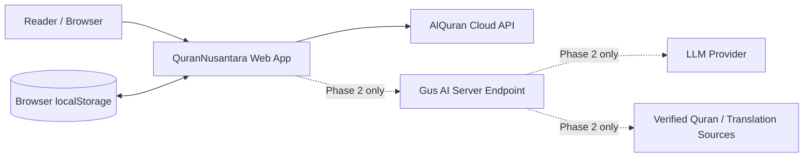
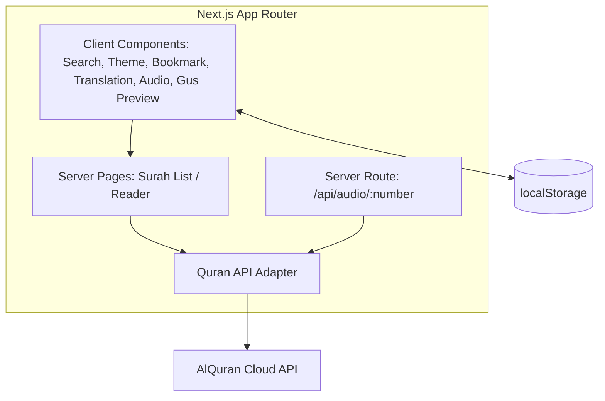

# Software Architecture — QuranNusantara

## 1. Architectural style

A small Next.js App Router application with server-rendered pages, client-side UI state for interactions, and a thin provider adapter around the external Quran content API. The MVP has no authentication and no database.

This is an intentionally lightweight architecture. Expand only when new needs justify it.

## 2. System context

## 3. Container/component view

## 4. Route inventory

| Route | Purpose | Rendering / state |
|---|---|---|
| `/` | Surah browser | Server fetches metadata; client search/filter UI |
| `/surah/[number]` | Read one surah | Server fetches Arabic and two translation editions; client handles translation selector, bookmarks, audio UI and last-read state |
| `/bookmarks` | Saved verses | Client reads local browser storage |
| `/api/audio/[number]` | Resolve ayah audio URL | Server-side proxy/lookup; no secret is expected for the initial provider |
| Future `/api/chat` | Gus AI conversation | Phase 2 only; server-side provider key, validation, rate limits, source retrieval and evaluation |

## 5. Data flow

### Surah list
1. Request `/`.
2. Server requests `GET /surah` from configured provider.
3. Provider response is validated by the adapter.
4. Surah metadata is passed to the browser component.
5. Search/filter happens locally against metadata.

### Reader
1. Request `/surah/{number}`.
2. Validate number is an integer from 1 through 114.
3. Server requests the Arabic edition plus Indonesian and English translations.
4. Adapter verifies the three responses and ayah arrays exist.
5. Reader renders the Arabic text and one selected translation at a time.

### Local reading state
- Bookmarks: `qn-bookmarks-v1`.
- Last read: `qn-last-read-v1`.
- Translation preference: `qn-translation-v1`.
- Theme: `qn-theme` (managed by `next-themes`).

These values are browser-local and are not synced across devices. They should not be treated as durable backups.

## 6. External dependencies and resilience

- Provider calls are cached with revalidation where appropriate.
- UI must show an error/retry state on provider failure.
- Audio failure must not block text reading.
- Do not call audio endpoint for every verse on page load; resolve the URL when a user requests playback.
- Treat upstream response shape and edition availability as external dependencies; handle changed/missing fields safely.

## 7. Security and privacy boundaries

Phase 1:
- No auth, no database, no user profile.
- User preferences and reading/bookmark state stay in localStorage.
- Do not put private keys in client bundles.
- Do not store more user data than necessary.

Phase 2 Gus AI:
- Add a server-side route only after defining scope and evaluation criteria.
- Keep the model API key server-side in environment variables.
- Validate input length and shape, add rate limiting/abuse controls, and handle provider timeouts.
- Retrieve or otherwise verify relevant source references before prompting the model.
- Cite source/edition and ayah references in responses where available.
- Separate source text from model-generated explanation.
- Document external data processing and retention.

## 8. Deployment target

- Git repository: GitHub.
- Web hosting target: Vercel.
- Build/runtime: Next.js App Router on supported Node.js runtime.
- No database required in Phase 1.
- Public deployment is gated on content-terms review, functional QA, build success, and accessibility checks.

## 9. Current architectural limitations

- No API response schema validation library yet; adapter performs basic runtime checks.
- No automated API contract tests or mock server yet.
- No offline mode.
- No cross-device user sync.
- Gus AI is not implemented.

## References

- [Next.js App Router installation](https://nextjs.org/docs/app/getting-started/installation)
- [Next.js Route Handlers](https://nextjs.org/docs/app/getting-started/route-handlers)
- [AlQuran Cloud API reference](https://alquran.cloud/api)
- [Vercel + Next.js](https://vercel.com/frameworks/nextjs)
